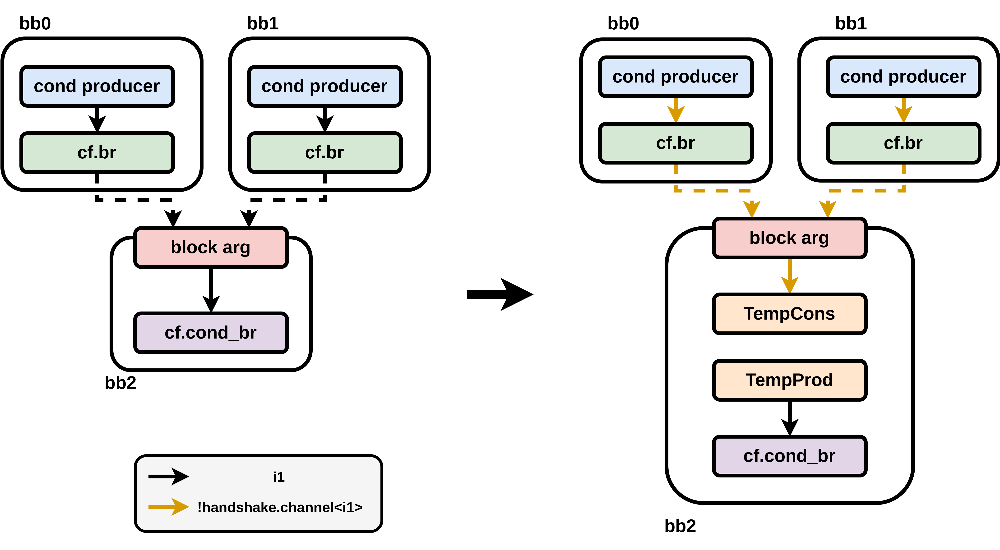
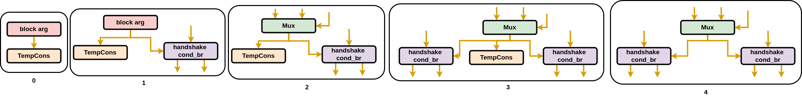
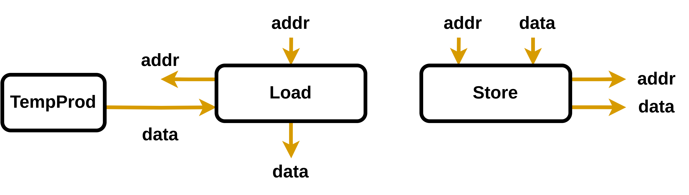
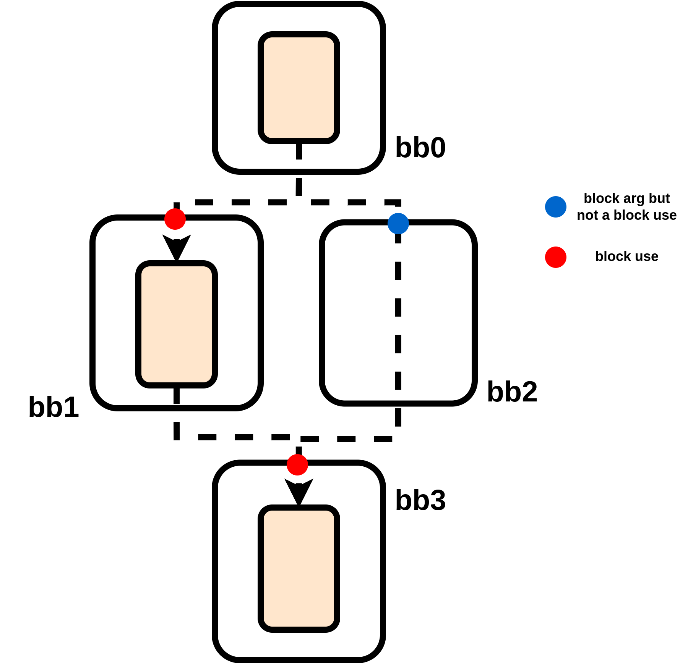

# CF to Handshake Lowering

## The CfToHandshake Pass

### Step 1: Validate Incoming Names

Requirements:

- Every load and store has a unique name.
- No other op has a name.

The memory dependency attribute system works by name, so loads and stores must be named.

Other ops are left unnamed to simplify lowering, as maintaining consistent names between the two (quite different) IRs introduces a mild complexity overhead.

### Step 2: Validate There Is One Function

Requirements:

- There is exactly one function with a body.

### Step 3: Lower the Function

See [Lowering the Function](#lowering-the-function).

### Step 4: Erase the Global Ops

Every `memref.global` op is erased (including any the kernel never reads). They can't be erased while making the RAM ops, since a RAM op is placed per reference to a global array in the kernel.

## Lowering the Function

### Step 1: Validate the Function

Requirements:

- The function calls no other function.
- The function has a single return.

Functions with multiple returns can be preprocessed with the `--func-merge-returns` pass, which `compile.sh` runs before the lowering.

### Step 2: Convert Internal Arrays to RAM Operations

An internal array's memref comes from a `memref.alloca` op or a `memref.get_global` op. The pass replaces that op with a `handshake.ram` op producing the same memref, so the array's loads and stores now access the RAM op:

- A local array (`memref.alloca` op) becomes a RAM op that starts as all zeros.
- A constant global array (`memref.get_global` op of a constant `memref.global` op) becomes a RAM op that starts as the global's initial value. A non-constant global is rejected, since it is not guaranteed to be reset to its initial value on each invocation of the kernel, which would mean state across invocations.

### Step 3: Map Each Basic Block to Its Branch Condition

The control-network routing algorithm needs each basic block's branch condition as an MLIR value in that basic block. MLIR values cannot be stored directly, as they can go stale during conversion.

A second problem: The control-network routing algorithm needs the `cf.cond_br` ops in order to process the CFG, and so they must remain in the IR until the algorithm completes. The control-network routing algorithm places handshake branches, which take handshake-channel-typed operands. However, the `cf.cond_br` ops must receive integer-typed operands.

To solve both problems, we break the connection between a `cf.cond_br` op and its condition producer. A temporary consumer, in the form of a `TempCons`, is placed in the same basic block as the `cond_br` op, consuming the output of the condition producer. A temporary producer, in the form of a `TempProd`, is also placed in the same basic block as the `cond_br` op, but producing an `i1` value for the `cf.cond_br` op's condition operand.



The transformation is shown above (including the conversion from integer to handshake channels, which actually happens later). The operand of the temporary consumer is now the MLIR value that the control-network routing algorithm needs: a handshake channel in the correct basic block. `BlockToCond` exposes a mapping from basic block to this MLIR value, avoiding staleness by storing the `TempCons`.

As the `TempCons` is present in the IR in the correct basic block, it is handled by the control-network routing algorithm like any other data path. As a consequence, the branches placed by the control-network routing algorithm have fully routed condition operands when routing finishes, without additional handling required. Any branches placed before the `TempCons` is routed take their condition operand from the block arg. When the `TempCons` is routed, it is disconnected from the block arg and connected instead to its real, post-routing handshake-level producer: this is done also for all branches already placed. Any branches placed after the `TempCons` has been routed take their condition operand directly from that real, post-routing handshake-level producer.



Above shows a sample flow, where a branch placed before the `TempCons` is routed is connected to the block arg. Then the `TempCons` is routed and both the `TempCons` and the branch are connected to a multiplexer instead. A branch added after `TempCons` is routed is connected directly to the multiplexer. Once routing completes, the `TempCons` (along with the `cf.cond_br` op and the `TempProd`) is removed from the IR.

### Step 4: Create the Handshake Function

`createHandshakeFunction` builds a `handshake.func` op from the `func.func` op.

First we must build the arguments. Each scalar argument of the original function becomes an equivalent handshake-typed scalar argument. An array argument (represented by a memref) remains the same (with one exception: index-typed arrays are converted to `i32`-typed arrays). After the original arguments, we then add additional control arguments. For each array (both function-argument arrays and internal arrays), we add a handshake-typed control, the array's start input. Finally, a start argument is added, which is also a handshake-typed control.

The results are handled in the same manner.

The function body is then moved from the `func.func` op into the `handshake.func` op.

Every block argument, in every basic block, is then converted to its handshake type.

In MLIR, a function's arguments are its entry block's arguments, so the entry block also receives the additional control arguments: a start control for each array, then the start control.

`createHandshakeFunction` returns a `HandshakeFunction` struct, holding the `handshake.func` op (`funcOp`), the start control argument (`start`), and a map from each array's memref to its start control argument (`memStarts`).

### Step 5: Build the Base CFG

`getBaseCfg` walks every basic block of the IR once to build a simple, traditional CFG: each `cf.br` op gives an edge, each `cf.cond_br` op gives a true edge and a false edge, the first basic block is the entry, and the basic block ending in the `func.return` op is the exit.

### Step 6: Annotate the Memory Interface CFGs

Each memory interface has control inputs which are used to track what memory accesses will arrive at the interface, and in what order. We generate these control inputs by modelling an abstract "allocation credit": we model the allocation credit being passed to the control input of a memory interface as that credit being consumed and then re-defined. This means the memory interface is guaranteed to receive its control inputs sequentially in program order.

An MC has one control input per basic block with a store. An LSQ has one control input per basic block with a memory access (load or store). To annotate the memory interface CFGs, we make a copy of the base CFG, and label it with which basic blocks have a corresponding control input for a given memory interface.

There is one extra complication: We must also pass a special "end" control input, which indicates that no other control inputs will arrive. An MC always has such a control input. An LSQ sometimes has such a control input (when the array has no MC). If there is already a control input corresponding to the exit basic block, we must generate two: one corresponding to the exit block, and one corresponding to the end of program execution.

This is mildly annoying to handle, but not impossible: it might be worth thinking about simplifying this system in future.

### Step 7: Convert Constants

`convertConstants` replaces each constant with a `handshake.constant` op. A constant is triggered by a source, unless one of its consumers must receive exactly one token per execution of the constant's basic block. In that case, it is triggered by the start argument of the handshake function instead. The use of an undefined variable is treated as a zero-valued constant triggered by the start argument.

### Step 8: Convert Arith and Math Ops

`convertArithAndMath` replaces each arith op and math op with its handshake equivalent. Almost all ops are converted with a one-to-one mapping. Some basic casting simplification is done here: future work should investigate if this pass should handle more of the bitwidth optimization.

### Step 9: Convert Loads and Stores

`convertLoadsAndStores` replaces each `memref.load` op and `memref.store` op with a `handshake.load` op or `handshake.store` op.

The data input of a load op is produced by its memory interface, which has not yet been built. So a temporary producer (a `TempProd`) is placed as the load's data input, to stand in for that data. The addr outputs of the loads and the addr and data outputs of the stores should also connect to that memory interface. Therefore, each load and store is recorded in `memrefToAccesses` under its array's memref, in program order, so they can be connected to the memory interface once it is built.

```mlir
// before
%data = memref.load %array[%addr] : memref<64xi32>

// after
%dataFromMem = TempProd : <i32>
%addrToMem, %data = handshake.load [%addr] %dataFromMem : <i32>, <i32>
```

```mlir
// before
memref.store %value, %array[%addr] : memref<64xi32>

// after
%addrToMem, %dataToMem = handshake.store [%addr] %value : <i32>, <i32>
```



### Step 10: Maximize SSA

To make the analysis of the control-network routing algorithm simpler, we now perform SSA-maximization. As constants have already been converted, this also SSA-maximizes the start function arg to all basic blocks with unsourceable constants.

### Step 11: Collect the Block Uses

Any straight data path with an input from another straight data path requires the control-network routing algorithm to efficiently and correctly deliver data between them.

After SSA maximization, we identify such inputs through the block arguments of the basic blocks, and refer to them as a "block use". However, not all block arguments are block uses: a block use is a block argument with a real consumer, meaning an op in its basic block that uses the value, rather than a `cf.br` op or `cf.cond_br` op that only forwards it to a successor basic block. Function arguments are also not block uses, as we instead treat them simply as producers in the entry basic block.



Above shows three straight data paths in four basic blocks, which need routing between them. There are two block uses, shown in red, at the block args into data paths. The block arg of basic block 2 is not a block use, as there is no real consumer.

### Step 12: Cluster the Block Uses

The control-network routing algorithm runs on a CFG annotated with per-edge live-outs. To annotate a CFG, we must know exactly which block uses will be routed.

For N block uses, we could make N annotated CFGs (annotated based on a single block use), and run the control-network routing algorithm N times. Or, we could make a single annotated CFG (annotated based on all block uses) and run the control-network routing algorithm once. Or, we could cluster the block uses, and run the control-network routing algorithm once per cluster.

When we use N annotated CFGs for N block uses, a block use is routed based purely on its real control-flow dependencies, enabling maximum task-level parallelism. When clustering is used, a block use is routed based on the union of the control-flow decisions that affect block uses in the cluster. When we use a single annotated CFG, a block use is routed based on the union of the control-flow decisions that affect all block uses. Waiting for unrelated control flow to resolve before routing data reduces the task-level parallelism in the circuit. However, running the control-network routing algorithm for each block use results in more complex circuits.

This clustering is the central change of the current implementation of CF to Handshake compared to Dynamatic's historical approach. Before, it was assumed the control-network routing algorithm was only valid when run on an unoptimized CFG containing all block uses.

Insightful clustering has not yet been explored and so clustering in general is not yet supported: CF to Handshake currently annotates a unique CFG per block use, and achieves highly performant but complex circuits.

### Step 13: Annotate the Block-Use CFGs

`buildCfg` annotates a copy of the base CFG for a set of block uses, by tracing each block use back to its producers, recording the live-out carried on every edge it crosses. It also marks which basic blocks are needed: the basic block of each block use and the basic block of each producer. The entry and exit blocks are also marked, regardless of block uses and producers, to make the control network easier to build.

### Step 14: Optimize the CFGs

Each annotated CFG is optimized to remove the control-flow decisions that do not affect its needed basic blocks.

### Step 15: Route the CFGs

`routeCfgs` runs the control-network routing algorithm once on each optimized CFG.

#### Routing a Block-Use CFG

##### The Control Network

We first build the control network: a single-token, dataless circuit used to generate multiplexer select operands. As its single token moves between the basic blocks in program order, the multiplexers it controls are also constrained to route data in program order. The control network is built using the same routing algorithm: with a single token, it can safely produce the `select` values rather than requiring them.

##### Route the Block Uses

The control-network routing algorithm processes each basic block independently, using temporary producers in place of its inputs. Once every basic block has been processed, each temporary producer is replaced by the routed corresponding output of the predecessor basic block.

```python
control_network = build_control_network(cfg)
for bb in cfg:
    # place multiplexers, and wire temporary inputs into each bb
    for input in bb.inputs:
        match bb.num_predecessors():
            case 1:
                routed_ins[input] = temp()
            case n if n >= 2:
                select = control_network.control_merge(bb)
                routed_ins[input] = mux(select, temps())

    # connect the routed inputs to the bb's straight data paths
    sdp_outs = connect_straight_data_paths(bb, routed_ins)

    # per cfg edge: place discarders, and wire outputs through them
    for out in bb.live_outs:
        if bb.defines(out):
            val = sdp_outs[out]
        else:
            val = routed_ins[out]
        match bb.num_successors():
            case 1:
                routed_outs[out] = val
            case 2:
                routed_outs[out] = discarder(val, out.cond)

for bb in cfg:
    # replace the temporary bb inputs by wiring the corresponding bb output
    for input in bb.inputs:
        live_outs = input.get_incoming_live_outs()
        routed_ins[input].replace_temps(routed_outs[live_outs])
```

#### Routing a Memory Interface CFG

Each memory interface CFG is routed with the same algorithm. However, in each basic block with a control input, it places a lazy fork as the straight data path. The use of a lazy fork means the allocation credit cannot pass through the lazy fork towards the next control input until the current control input accepts it.
